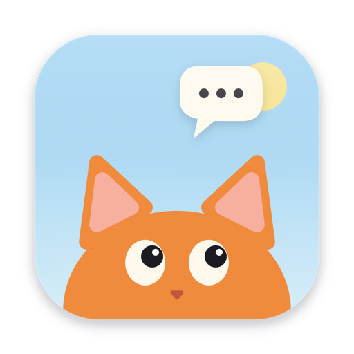
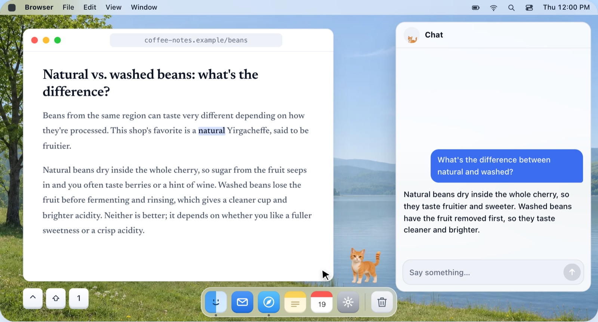
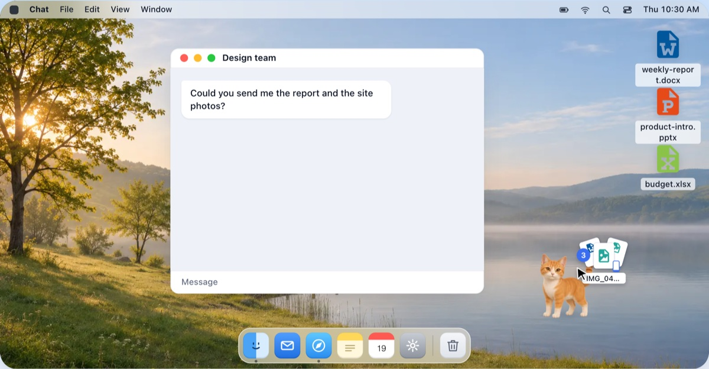
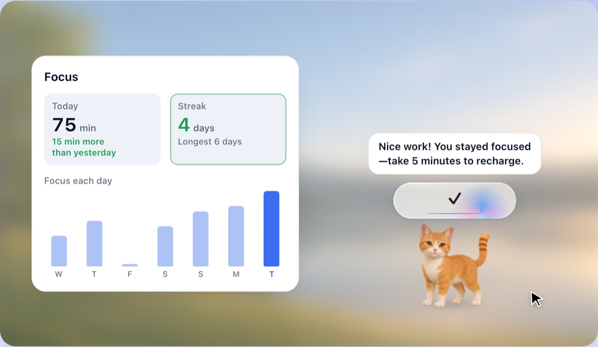

<p align="center">
  
</p>

<h1 align="center">Suiby</h1>

<p align="center">
  A quiet, local-first desktop utility for macOS &amp; Windows — living in the corner of your screen as a customizable AI companion.
</p>

<p align="center">
  <a href="https://suiby.ajulyroom.com/en/">Website &amp; Interactive Demos</a>
  &nbsp;·&nbsp;
  <a href="https://suiby.ajulyroom.com/en/#download">Download</a>
  &nbsp;·&nbsp;
  <a href="https://suiby.ajulyroom.com/en/guide/">Product Guide</a>
  &nbsp;·&nbsp;
  <a href="README.zh-CN.md">简体中文</a>
  &nbsp;·&nbsp;
  <a href="LICENSE">MIT License</a>
</p>

<p align="center">
  <a href="https://suiby.ajulyroom.com/en/">
    
  </a>
</p>

<p align="center">
  <sub>Quiet while you work, handy the moment you need it. Click any preview to try the interactive demos on <a href="https://suiby.ajulyroom.com/en/">suiby.ajulyroom.com</a>.</sub>
</p>

---

## Why Suiby

I wanted a desktop companion that brings a little warmth and quiet company to the screen — while also being a genuinely useful everyday utility.

Instead of splitting clipboard history, a drag-and-drop file shelf, phone-to-computer transfer, a Pomodoro timer, quick translation, and a lightweight AI sidebar across five separate apps, Suiby brings them together in one lightweight native app (Tauri + Rust) that follows macOS and Windows platform materials, stays quietly in the corner of your screen, and lets you customize the companion itself with AI.

<table>
  <tr>
    <td width="50%" align="center">
      <a href="https://suiby.ajulyroom.com/en/#pile">
        
      </a>
      <br />
      <sub><strong>File shelf &amp; LAN phone transfer</strong> — drop files onto your pet, or scan a QR code on your phone to send photos and files over local Wi-Fi.</sub>
    </td>
    <td width="50%" align="center">
      <a href="https://suiby.ajulyroom.com/en/#things">
        
      </a>
      <br />
      <sub><strong>Minimal focus timer</strong> — a quiet Pomodoro pill above your pet that shrinks to a hairline bar and tracks daily focus time.</sub>
    </td>
  </tr>
</table>

---

## What It Does

### Works 100% offline (no account, no API key)

- **Clipboard history** — local searchable history for copied text and images; press a shortcut and hit Enter to paste.
- **File shelf &amp; LAN phone transfer** — temporarily hold files across windows, or scan a QR code from your phone to send photos, files, and text directly over local Wi-Fi with no cloud upload or compression.
- **Focus timer &amp; reminders** — minimal corner Pomodoro timer with daily/weekly stats, plus local to-dos and scheduled reminders.
- **Native desktop pet** — transparent click-through corner companion with eye tracking, built-in animations, and native macOS / Windows studio windows.

### Optional AI companion (off by default)

Turn on the AI brain only if you want it, using your own API key (OpenAI, Anthropic, Google Gemini, DeepSeek, etc.) or a local model (Ollama, LM Studio):

- **Slide-out AI sidebar &amp; bubbles** — ask without switching windows, then tuck it away.
- **Select-to-translate &amp; screenshot vision** — highlight text in any app to translate, explain, polish, or summarize; capture any screen region to ask about what you see.
- **Long-term memory &amp; local document Q&amp;A** — remembers preferences across chats and answers from local PDF / Word files, with optional web search and MCP tools.

### Custom pets &amp; new moves

Let your imagination run wild — turn a photo of your own cat or dog, a favorite character, or any idea you picture (a pixel robot, a drizzling little cloud, a sleepy slice of toast) into a desktop pet that lives on your screen. Suiby includes built-in Skills (`make-desktop-pet`, `teach-desktop-pet`) and an open [inbox protocol](docs/收件箱约定.md) to create custom pets, teach them new animated moves, and share pet packs as ZIP files.

> **Tested recommendation for creating pets &amp; moves:** Unlike everyday chat/translation (which works with any cloud API or local model), generating new pets and animated moves requires a **local AI agent that can both generate images and operate your local filesystem/commands**. In our hands-on testing so far, **OpenAI Codex** has been the most consistent; other tools haven't tested as reliably across image generation and local packaging yet.

---

## Privacy &amp; Local-First Guarantee

| Area | Where your data goes |
| --- | --- |
| Clipboard, file shelf, Pomodoro, local to-dos, pets | **100% local** on your machine |
| Phone-to-computer QR transfer | **Local Wi-Fi only** (peer-to-peer, never touches a cloud server) |
| Optional AI chat, translation, vision | Sent **directly from your computer** to the model provider you configure — or stays **100% offline** with local models like Ollama |
| Telemetry / backend servers | **None.** Suiby runs no backend server and collects zero analytics. |

### System Permissions &amp; Transparency

Every OS permission is optional and only requested when you use the corresponding feature:

| Permission | What it is used for | If you don't grant it |
| --- | --- | --- |
| **Input Monitoring (macOS)** | **Not required.** Double-copy translate watches clipboard changes without global keystroke logging ([`clipboard/`](apps/desktop/src-tauri/src/clipboard/)). | Always works without it |
| **Accessibility** | Direct Enter-to-paste from clipboard history and reading selected text for replace-with-translation. | Clipboard history automatically falls back to copying to your system clipboard |
| **Screen Recording** | Region screenshot capture for AI vision questions. | Only screenshot-to-AI is unavailable |
| **Local Network** | Phone-to-computer QR transfer (ephemeral LAN HTTP server with a 24-character access token, auto-closes after 10 min idle — use on trusted Wi-Fi only). | Only phone LAN transfer is unavailable |

- **Credentials &amp; sensitive clipboard data:** API keys are stored in macOS Keychain / Windows Credential Manager ([`credentials.rs`](apps/desktop/src-tauri/src/credentials.rs)). Concealed/password-manager clipboard items (such as 1Password) are skipped automatically. See [SECURITY.md](SECURITY.md) for the full security model.

---

## Download, Verification &amp; First-Launch Note

Prebuilt installers are available on the [website](https://suiby.ajulyroom.com/en/#download) and [GitHub Releases](https://github.com/anotherdayblues/suiby/releases):

- **macOS (Apple Silicon):** `Suiby-Mac-arm64.dmg`
- **Windows (x64):** `Suiby-Windows-x64.exe`

**Verifiable public CI builds:** Both macOS and Windows release packages are compiled publicly from this repository via GitHub Actions ([`.github/workflows/release.yml`](.github/workflows/release.yml)) with `SHA256SUMS.txt` and GitHub Build Provenance Attestations:

```bash
# Verify downloaded installer provenance against this repository
gh attestation verify Suiby-Mac-arm64.dmg --repo anotherdayblues/suiby
gh attestation verify Suiby-Windows-x64.exe --repo anotherdayblues/suiby
```

The macOS installer has not been notarized by Apple, and the Windows installer is unsigned. Your OS may show a warning on first launch:

- **macOS:** Drag `Suiby.app` into `Applications`, open it once, click **Done** on the warning, then go to **System Settings → Privacy &amp; Security** and click **Open Anyway**.
- **Windows:** On the SmartScreen prompt, click **More info → Run anyway**.

If you prefer not to bypass an unsigned prompt, you can inspect the source and build Suiby yourself below.

---

## Build from Source

### Prerequisites

- **Node.js 22+** (24 recommended)
- **Rust toolchain** (`rustup` / `cargo`)
- **Python 3.10+** (only needed for Python skill unit tests, via `requirements-dev.txt`)

### Common Commands

```bash
# Install dependencies
npm ci

# Launch desktop app in dev mode (Tauri + Vite + AI Brain)
npm run desktop

# Build desktop frontend
npm run build

# Run TypeScript and Brain tests
npm test

# Run Rust host unit tests
cd apps/desktop/src-tauri && cargo test
```

---

## Repository Layout

| Path | Description |
| --- | --- |
| `apps/desktop/` | Desktop app UI (`src/`) and Rust / Tauri host (`src-tauri/`) |
| `apps/brain/` | Optional AI sidecar (`Bun` + TypeScript) and system prompts |
| `apps/shared/` | Shared types, model catalog, and `zh` / `en` locales |
| `skills/` | Built-in `make-desktop-pet`, `teach-desktop-pet`, and `find-pet-tool` skills |
| `examples/` | Sample pet packs (`lizi`, `mika`) and taught animation packs |
| `docs/` | Inbox protocol and design documentation |
| `scripts/`, `tests/` | Build/release automation (including Retina DMG builder) and test suites |
| `third-party/` | Third-party licenses and attributions ([NOTICE.md](third-party/NOTICE.md)) |

---

## License &amp; Acknowledgements

Suiby is open-source software licensed under the [MIT License](LICENSE).  
Third-party libraries and sample asset attributions are documented in [third-party/NOTICE.md](third-party/NOTICE.md).
