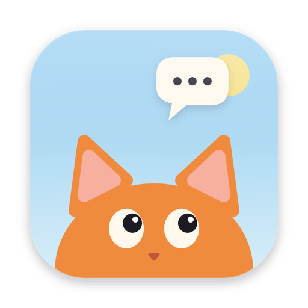
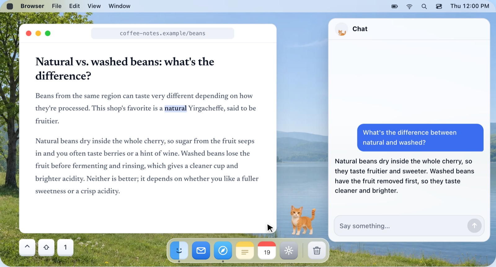
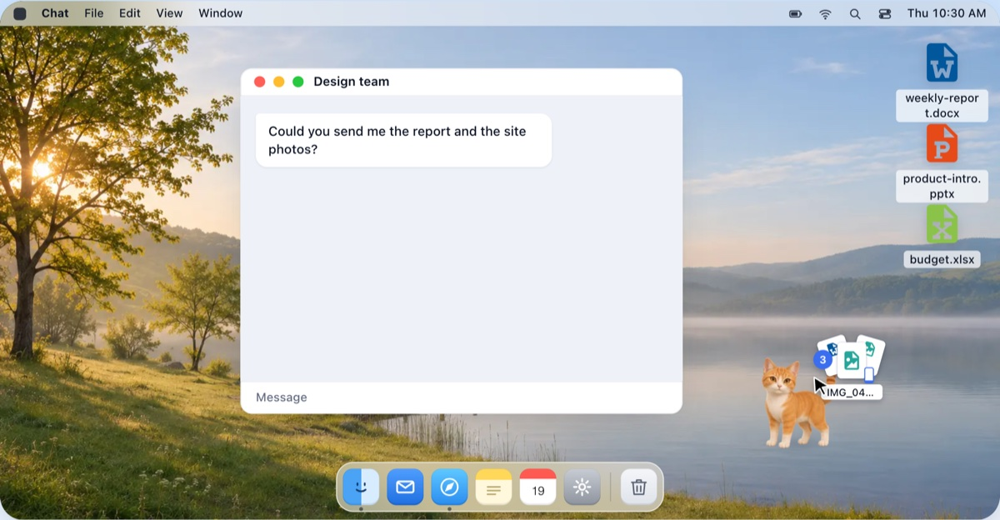
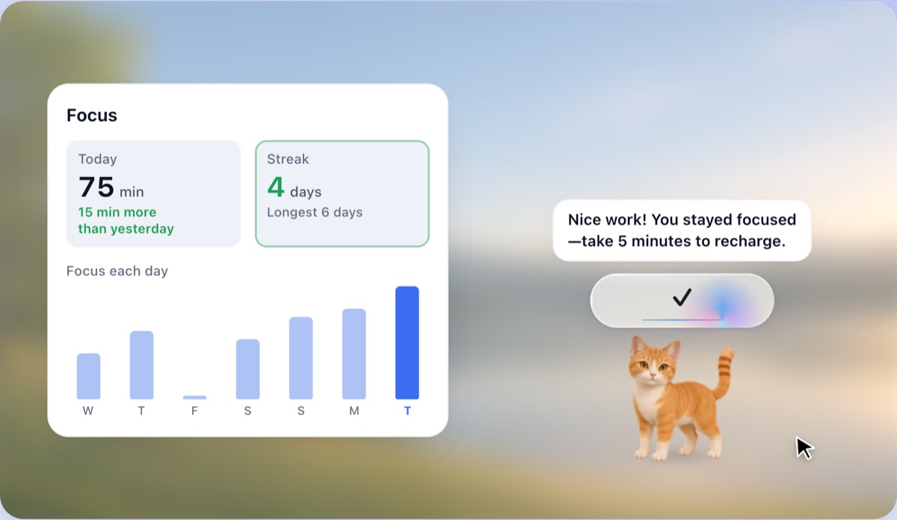

<p align="center">
  
</p>

<h1 align="center">随伴 · Suiby</h1>

<p align="center">
  安静住在屏幕角落的免费开源桌面效率工具（macOS &amp; Windows）——集齐高频桌面小工具，还能定制属于你的 AI 桌宠。
</p>

<p align="center">
  <a href="https://suiby.ajulyroom.com/">官网与交互演示</a>
  &nbsp;·&nbsp;
  <a href="https://suiby.ajulyroom.com/#download">下载体验</a>
  &nbsp;·&nbsp;
  <a href="https://suiby.ajulyroom.com/guide/">产品指南</a>
  &nbsp;·&nbsp;
  <a href="README.md">English</a>
  &nbsp;·&nbsp;
  <a href="LICENSE">MIT 协议</a>
</p>

<p align="center">
  <a href="https://suiby.ajulyroom.com/">
    
  </a>
</p>

<p align="center">
  <sub>你忙，它安静；你用，它顺手。点击任意图片前往 <a href="https://suiby.ajulyroom.com/">suiby.ajulyroom.com</a> 体验全部交互演示。</sub>
</p>

---

## 为什么做随伴

做随伴的初衷很简单：我希望它在屏幕角落带来一点温柔的情绪陪伴的同时，本身也是一件真正顺手好用的日常工具。

不用再为剪贴板历史、跨窗口文件中转站、手机局域网互传、番茄钟专注计时、划词翻译和轻量 AI 侧边栏分别装四五个软件——随伴用 Tauri + Rust 把这些高频效率能力收进一个遵循 macOS 与 Windows 原生质感的轻量应用里：你忙的时候它安静陪着，需要的时候随手就用，还能用 AI 把它定制成你自己喜欢的样子。

<table>
  <tr>
    <td width="50%" align="center">
      <a href="https://suiby.ajulyroom.com/#pile">
        
      </a>
      <br />
      <sub><strong>文件中转站 &amp; 手机局域网互传</strong> — 文件往宠物身上一丢暂存，或手机扫码在同一 Wi-Fi 下直传照片与文件，不经过云盘、不压缩。</sub>
    </td>
    <td width="50%" align="center">
      <a href="https://suiby.ajulyroom.com/#things">
        
      </a>
      <br />
      <sub><strong>极简番茄钟专注</strong> — 挂在宠物头顶的轻量专注条，平时缩成细条不挡屏幕，自动记录每日与每周专注时长。</sub>
    </td>
  </tr>
</table>

---

## 核心能力

### 100% 纯离线免费使用（无需账号、无需 API Key）

- **剪贴板历史**：本地记录复制过的文本与图片，快捷键检索、回车直接粘贴。
- **文件中转站 &amp; 手机互传**：跨窗口拖拽暂存文件；手机扫码在局域网内与 Mac / Windows 直传照片、文件与文字，不限速、不走公网。
- **专注计时 &amp; 待办提醒**：角落极简番茄钟与每日统计，支持本地待办与到点提醒。
- **原生桌宠本体**：透明点击穿透、视线跟随、内置动作动画，以及遵循 Mac / Windows 原生规范的主窗口。

### 按需开启的 AI 伙伴（默认关闭）

只有你主动开启时才启用，支持自带云端模型 Key（OpenAI、Anthropic、Gemini、DeepSeek 等）或接入本地大模型（Ollama、LM Studio）：

- **AI 侧边栏与气泡**：不切窗口随时拉出提问，用完即收。
- **划词翻译 &amp; 截屏识图**：在任意软件里选中文字即可翻译、解释、润色或总结；快捷键截屏直接对着画面提问。
- **长期记忆 &amp; 本地文档问答**：记住你的习惯与偏好，支持把 PDF / Word 放进资料库检索回答，也支持按需接入联网搜索与 MCP 工具。

### 定制自己的宠物 &amp; 教新动作

发挥你的想象力——不管是自家猫狗的照片、喜欢的二次元或插画角色，还是任何天马行空的形象（像素小机器人、会下小雨的云朵、爱睡觉的吐司），都可以做成真正住在桌面上的宠物。内置 `make-desktop-pet`、`teach-desktop-pet` Skills 与开放的 [收件箱约定](docs/收件箱约定.md)，支持自由创作宠物、教它自定义触发动作，并导出为 ZIP 宠物包分享给朋友。

> **造宠与教新动作的实测推荐**：日常 AI 聊天与划词翻译不挑模型（云端 API 或本地模型均可）；但「造新宠物 / 教新动作」需要**同时具备「生图能力」与「操作本机文件/命令能力」的本地 AI Agent**。在我们的实际测试里，目前 **OpenAI Codex** 最稳定，其他工具在生图或本地打包环节测试还不够稳定，建议优先选用 Codex。

---

## 隐私与本地优先承诺

| 模块 | 数据流向 |
| --- | --- |
| 剪贴板历史、文件中转站、番茄钟、本地待办、桌宠本体 | **100% 留在本机** |
| 手机扫码与电脑互传文件 / 照片 | **仅限局域网点对点直连**，不经过任何云盘或公网服务器 |
| 按需开启的 AI 对话、划词翻译、截屏识图 | **从本机直连你填写的模型服务商**（接入 Ollama 等本地模型时彻底零出网） |
| 后台服务器 / 统计埋点 | **无。** 随伴没有后台服务器，不收集任何用户行为数据。 |

---

## 下载与首次打开说明

预编译安装包可在 [官网](https://suiby.ajulyroom.com/#download) 或 [GitHub Releases](https://github.com/anotherdayblues/suiby/releases) 下载：

- **macOS（Apple 芯片）**：`Suiby-Mac-arm64.dmg`
- **Windows（x64）**：`Suiby-Windows-x64.exe`

目前 macOS 安装包尚未经过 Apple 公证，Windows 安装包尚未签名。首次打开时，系统可能会显示安全提示：

- **macOS**：将 `Suiby.app` 拖进 `Applications` 后双击，遇到「无法验证」弹窗点 **完成**，再到 **系统设置 → 隐私与安全性** 滑到底部点 **仍要打开** 即可（放行一次后永久正常打开）。
- **Windows**：SmartScreen 蓝色窗口点 **更多信息 → 仍要运行**。

如果你介意未签名提示，完全可以直接查阅源码并在本地自行编译。

---

## 本地开发与源码构建

### 环境要求

- **Node.js 22+**（推荐 24）
- **Rust 工具链**（`rustup` / `cargo`）
- **Python 3.10+**（仅运行 Python Skill 测试时需要，依赖见 `requirements-dev.txt`）

### 常用命令

```bash
# 安装依赖
npm ci

# 启动桌面端开发模式（Tauri + Vite + Brain）
npm run desktop

# 构建桌面端前端
npm run build

# 运行 TypeScript 和大脑模块测试
npm test

# 运行 Rust 宿主单元测试
cd apps/desktop/src-tauri && cargo test
```

---

## 仓库结构

| 目录 | 说明 |
| --- | --- |
| `apps/desktop/` | 桌面端本体（TypeScript/CSS 界面 `src/` + Rust/Tauri 宿主 `src-tauri/`） |
| `apps/brain/` | AI 伙伴大脑 sidecar（Bun + TypeScript）与系统提示词 |
| `apps/shared/` | 桌面端与大脑共用的类型、模型目录与中英文文案 |
| `skills/` | 内置造宠、教新动作与找工具 Skills |
| `examples/` | 示例宠物包（`lizi`、`mika`）与示范动作包 |
| `docs/` | 收件箱协议与相关文档 |
| `scripts/`、`tests/` | 构建/发版脚本（含 Retina DMG 自动构建）与自动化测试 |
| `third-party/` | 第三方开源组件许可证与致谢（[NOTICE.md](third-party/NOTICE.md)） |

---

## 开源协议与致谢

本项目基于 [MIT License](LICENSE) 开源。  
第三方开源组件与示例素材的完整来源和许可证见 [third-party/NOTICE.md](third-party/NOTICE.md)。
